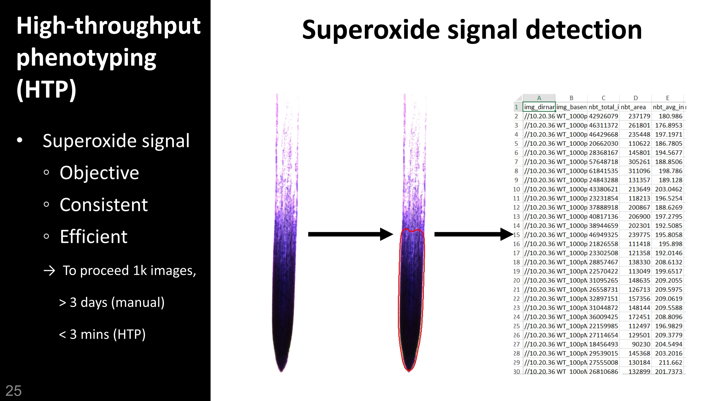
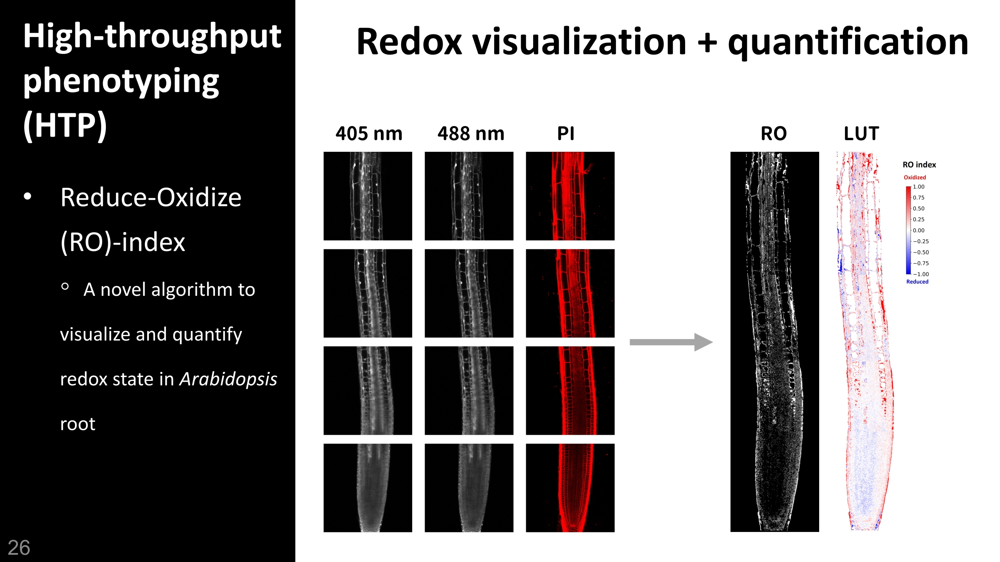
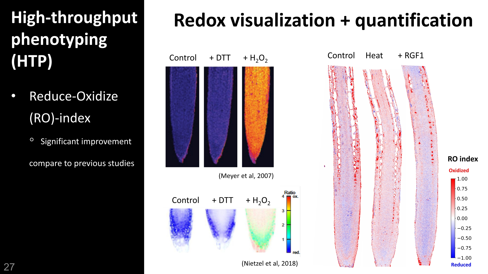

# rootpheno

[](https://cran.r-project.org/package=oneway)
[](https://pypi.org/project/rootpheno/)
[](https://pypi.org/project/rootpheno)
<!-- [](https://pepy.tech/projects/rootpheno) -->

Python package for plant root phenotyping.

# Installation

You can install the package from [PyPI](https://pypi.org/project/rootpheno/) with:

```
pip install rootpheno
```


# Current progress:

- Superoxide detection

  > [Download for Windows](https://github.com/mylab-root/NBT-stain_Ath/releases/download/software/NBT-Win64-2026Nov.exe),
  > [Testing data](https://drive.google.com/drive/folders/1swYiM0Dr7t4H5kcSw8jctvWsvwX-vdZ-?usp=sharing)

  - <i>Oryza sativa</i> root NBT-staining
  - <i>Arabidopsis thaliana</i> root NBT-staining

  > 


- Redox state quantification

  > [Download for Windows](https://github.com/mylab-root/RO-index_cytGRX-roGFP2/releases/download/software/roGFP2-Win64-2026Nov.exe),
  > [Testing data](https://drive.google.com/drive/folders/1DetuW187Xb4lVC8ENQPnM6IYl2fHknx0?usp=sharing)

  - Compute reduced-oxidized (RO) index of the cyto-roGFP2-GRX biosensor for <i>Arabidopsis thaliana</i>

  > 
  > 


- Cell structure visualization
  - <i>Arabidopsis thaliana</i> root propidium iodide (PI) staining


# TODO

- Hydrogen peroxide detection

- Cell proliferation